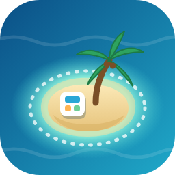
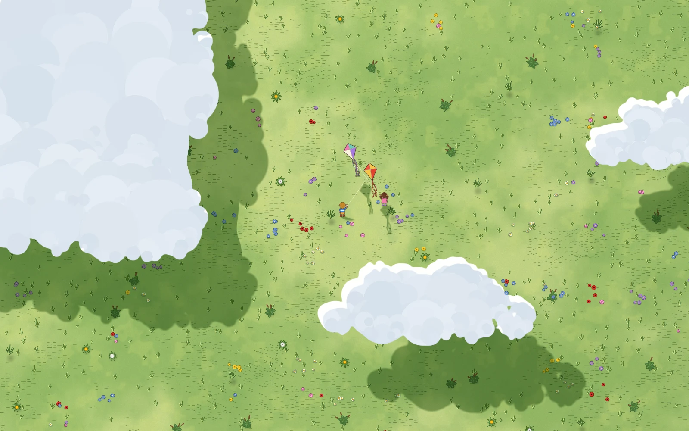

<p align="center"></p>

# Icon Island

**Adaptive Windows wallpaper that makes your desktop icons part of the scenery.**

Move, add or remove a desktop icon and the scenery quietly reshapes around it in real time — no AI, account or API key. This fork is **completely free**: every theme is unlocked, there are no locked previews, purchase screens or store hooks.




Icon Island is a free fork of [Deskland Preview](https://github.com/BLEZZ0102/Deskland) by its authors, released under the same GPL-3.0 license.

## What changed in this fork

- **All monitors:** one wallpaper window per display, each adapting to the icons that sit on that display. Plug or unplug a monitor and the layout rebuilds itself. Tray → *Use all monitors* switches back to primary-only.
- **Nine free themes:** Beach and Meadow (original) plus seven new ones — **Aurora**, **Sky** (day / dusk / night, with planes and birds), **Pasture**, **Forest** (summer / autumn / spring), **Lotus pond**, **Winter** (frozen ponds, skaters, reindeer and penguins) and **Zen Garden** (a raked sand garden with mossy islands, trees, lanterns and drifting petals; morning, golden hour or night). The new themes are original work built on the shared `prototype/kit.js` framework.
- **No locked content:** the 11 placeholder "locked" cards, the purchase dialog and the website link were removed.

## Themes

| Theme | Description |
| --- | --- |
| Beach | Turquoise waves, kayaks, seabirds and coconut palms. |
| Meadow | Drifting clouds and shadows, a boy flying a kite and a little black cat. |
| Aurora | Northern lights over a snowy ridge; icons become glowing lights joined by constellation lines. |
| Sky | Cartoon clouds that icons sit on; day, dusk or night. |
| Pasture | Patchwork fields; every group of icons gets its own fenced meadow with grazing cows and horses. |
| Forest | Gouache forest of broadleaf, spruce, pine and birch with roaming deer, boar, foxes and rabbits (summer / autumn / spring). |
| Lotus pond | Lily pads, lotus flowers and koi that swim between icons. |

## Requirements

- Windows 10 or 11, 64-bit, with Microsoft Edge WebView2 Runtime.
- PowerShell and the .NET Framework C# compiler that ship with Windows (no .NET SDK).
- Internet for the first build (downloads the WebView2 library). Node.js only for the browser preview.

## Build from source

```powershell
powershell -ExecutionPolicy Bypass -File host\build.ps1
host\bin\IconIsland.exe
```

Keep `host/` and `prototype/` together. Run the program again or double-click the tray icon to open Settings. Exit with the tray menu or `host\bin\IconIsland.exe --exit`. Settings and logs live in `%LOCALAPPDATA%\IconIsland`.

Theme pages (HTML/JS) can be edited without recompiling: use tray → *Reload*.

## Browser preview

```powershell
node prototype\serve.mjs
```

Open **http://localhost:5178/settings.html** (or e.g. `/sky.html` directly). The browser uses sample icons.

## Windows installer

```powershell
powershell -ExecutionPolicy Bypass -File tools\build-installer.ps1
```

## Adding your own theme

Create `mytheme.html` (copy `aurora.html`) and `mytheme.js` calling `IconIsland.theme({ params, init, rebuild, frame })` — the contract is documented at the top of `prototype/kit.js`. Then add an entry to `prototype/themes.json` (same structure as the existing ones, defaults identical to `params`), optional English strings under `themes.<id>` in `i18n/en.json`, and add the files to the list in `tools/build-installer.ps1`.

## Known limitations

- Windows Spotlight or a wallpaper slideshow can briefly flash when Windows changes the background image.
- All monitors use the same theme and settings.
- The installer is unsigned, so SmartScreen may warn.

## License

Source code and theme assets: [GPL-3.0](LICENSE). Third-party dependencies: [THIRD_PARTY_NOTICES.md](THIRD_PARTY_NOTICES.md). This is a fork of the upstream Icon Island project; the Icon Island name and icon are not licensed as trademarks, so if you distribute this fork, give it its own name and icon and state that it is a fork (see [TRADEMARKS.md](TRADEMARKS.md)).
