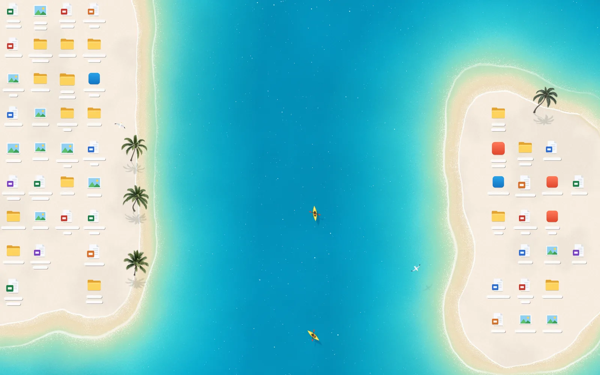

<p align="center"></p>

# Icon Island

**Adaptive Windows wallpaper that makes your desktop icons part of the scenery.**

Move, add or remove a desktop icon and the scenery quietly reshapes around it in real time — no AI, account or API key. This fork is **completely free**: every theme is unlocked, there are no locked previews, purchase screens or store hooks.




Icon Island is a free fork of [Deskland Preview](https://github.com/BLEZZ0102/Deskland) by its authors, released under the same GPL-3.0 license.

## What changed in this fork

- **All monitors:** one wallpaper window per display, each adapting to the icons that sit on that display. Plug or unplug a monitor and the layout rebuilds itself. Tray → *Use all monitors* switches back to primary-only.
- **Seven free themes:** Beach and Meadow (original) plus five new ones — **Aurora**, **Sky** (day / dusk / night), **Ocean**, **Forest** (summer / autumn / spring) and **Lotus pond**. The new themes are original work built on the shared `prototype/kit.js` framework.
- **No locked content:** the 11 placeholder "locked" cards, the purchase dialog and the website link were removed.

## Themes

| Theme | Description |
| --- | --- |
| Beach | Turquoise waves, kayaks, seabirds and coconut palms. |
| Meadow | Drifting clouds and shadows, a boy flying a kite and a little black cat. |
| Aurora | Northern lights over a snowy ridge; icons become glowing lights joined by constellation lines. |
| Sky | Cartoon clouds that icons sit on; day, dusk or night. |
| Ocean | Top-down sea; every icon is an island ringed by shallows and foam. |
| Forest | Gouache canopy with clearings around icons; three seasons. |
| Lotus pond | Lily pads, lotus flowers and koi that swim between icons. |

## Requirements

- Windows 10 or 11, 64-bit, with Microsoft Edge WebView2 Runtime.
- PowerShell and the .NET Framework C# compiler that ship with Windows (no .NET SDK).
- Internet for the first build (downloads the WebView2 library). Node.js only for the browser preview.

## Build from source

```powershell
powershell -ExecutionPolicy Bypass -File host\build.ps1
host\bin\IconIsland.exe
```

Keep `host/` and `prototype/` together. Run the program again or double-click the tray icon to open Settings. Exit with the tray menu or `host\bin\IconIsland.exe --exit`. Settings and logs live in `%LOCALAPPDATA%\IconIsland`.

Theme pages (HTML/JS) can be edited without recompiling: use tray → *Reload*.

## Browser preview

```powershell
node prototype\serve.mjs
```

Open **http://localhost:5178/settings.html** (or e.g. `/sky.html` directly). The browser uses sample icons.

## Windows installer

```powershell
powershell -ExecutionPolicy Bypass -File tools\build-installer.ps1
```

## Adding your own theme

Create `mytheme.html` (copy `aurora.html`) and `mytheme.js` calling `IconIsland.theme({ params, init, rebuild, frame })` — the contract is documented at the top of `prototype/kit.js`. Then add an entry to `prototype/themes.json` (same structure as the existing ones, defaults identical to `params`), optional English strings under `themes.<id>` in `i18n/en.json`, and add the files to the list in `tools/build-installer.ps1`.

## Known limitations

- Windows Spotlight or a wallpaper slideshow can briefly flash when Windows changes the background image.
- All monitors use the same theme and settings.
- The installer is unsigned, so SmartScreen may warn.

## License

Source code and theme assets: [GPL-3.0](LICENSE). Third-party dependencies: [THIRD_PARTY_NOTICES.md](THIRD_PARTY_NOTICES.md). This is a fork of the upstream Icon Island project; the Icon Island name and icon are not licensed as trademarks, so if you distribute this fork, give it its own name and icon and state that it is a fork (see [TRADEMARKS.md](TRADEMARKS.md)).

---

## 中文说明

[English](#icon-island-preview) · **简体中文**

**让桌面图标成为风景的一部分。**

Icon Island 是一款 Windows 自适应动态壁纸。移动、添加或删除桌面图标时，海岸线、草地、云朵和阴影会实时围绕图标调整。全部在本地实时演算，不使用 AI，无需账号或 API Key。

本仓库是**免费的开源体验版，不是限时试用版**，包含完整的沙滩和草地主题、Windows 宿主、设置界面与分享工具。

[官方网站](https://github.com/bigbuud/Icon-island) · [从源码运行](#build-from-source) · [许可](#credits-and-license)

### 包含的主题

| 沙滩 | 草地 |
| --- | --- |
|  |  |
| 海浪、皮划艇、海鸟和椰子树。 | 漂浮的云与云影、放风筝的男孩和小黑猫。 |

此分支另含五个原创主题：极光、天空、大海、森林、荷塘，全部免费开放，没有锁定主题。

### 功能

- **图标自适应：**读取真实桌面图标的位置，在移动、添加或删除时平滑调整场景。
- **两个完整主题：**沙滩和草地的全部参数均可调整并自动保存。
- **适合常驻桌面：**托盘控制、开机自动启动，前台窗口最大化或全屏时自动暂停。
- **隐私分享：**图片和动画使用示例图标与名字色块，不截取桌面窗口或真实文件名。
- **独立安装：**安装目录、用户数据、启动项和运行实例标识均独立，可与其他 Icon Island 版本共存。
- **简体中文和英文：**不包含登录、购买恢复、自动更新或商店接口。

### 系统要求

- Windows 10 / Windows 11，64 位。
- Microsoft Edge WebView2 Runtime。
- 使用 Windows 自带的 .NET Framework C# 编译器，无需安装 .NET SDK。
- 第一次构建需要联网下载 WebView2 开发库。
- 仅浏览器预览需要 Node.js。

支持**多个显示器**（每个显示器一个壁纸窗口；托盘菜单可切回仅主显示器），以核显 30fps 为目标。

### 从源码运行

在仓库根目录打开 PowerShell：

```powershell
powershell -ExecutionPolicy Bypass -File host\build.ps1
host\bin\IconIsland.exe
```

请保持 `host/` 和 `prototype/` 的相对目录结构，编译结果位于 `host/bin/`。

再次运行程序或双击托盘图标可打开设置。退出并恢复系统原壁纸，请使用托盘菜单或执行：

```powershell
host\bin\IconIsland.exe --exit
```

体验版的设置与日志独立保存在 `%LOCALAPPDATA%\IconIsland`。

### 浏览器预览

```powershell
node prototype\serve.mjs
```

打开 **http://localhost:5178/settings.html**。浏览器使用示例图标，真实桌面图标适配需要 Windows 宿主。

### Windows 安装包

```powershell
powershell -ExecutionPolicy Bypass -File tools\build-installer.ps1
```

首次构建会下载便携版 NSIS 和微软 WebView2 引导程序，无需安装全局开发工具。产物位于 `dist/`，附 SHA256 校验文件和对应源码 ZIP。

安装包安装到当前用户的 `Programs\Icon Island` 目录，无需管理员权限。缺少 WebView2 时需要联网安装；卸载保留用户设置。

[下载 Icon Island Windows 安装包](https://github.com/bigbuud/Icon-island/releases/latest)。安装包未签名，Windows SmartScreen 可能显示提示。

### 目录结构

| 路径 | 用途 |
| --- | --- |
| `host/` | Windows 宿主、构建脚本与清单 |
| `prototype/flat.html` | 沙滩主题 |
| `prototype/meadow.html` | 草地主题 |
| `prototype/settings.html` | 设置界面 |
| `prototype/themes.json` | 免费主题完整定义及锁定主题展示信息 |
| `prototype/share.js` | 隐私保护的图片和动画分享 |
| `prototype/assets/` | 随附主题图片素材 |
| `tools/` | 安装包构建工具 |

### 已知限制

- 所有显示器使用同一主题与设置。
- 使用 Windows 聚焦或壁纸幻灯片时，系统换图可能造成短暂闪烁。
- 体验版不包含账号登录、购买恢复、自动更新或其他主题实现。

### 许可与反馈

项目源码和随附主题素材按 [GPL-3.0](LICENSE) 发布，第三方依赖见 [THIRD_PARTY_NOTICES.md](THIRD_PARTY_NOTICES.md)。

Icon Island 名称与图标不作为商标授权授予；修改版应使用自己的名称和图标，详见 [TRADEMARKS.md](TRADEMARKS.md)。

欢迎通过 GitHub Issues 反馈问题和建议。个人项目，不保证即时回复。
